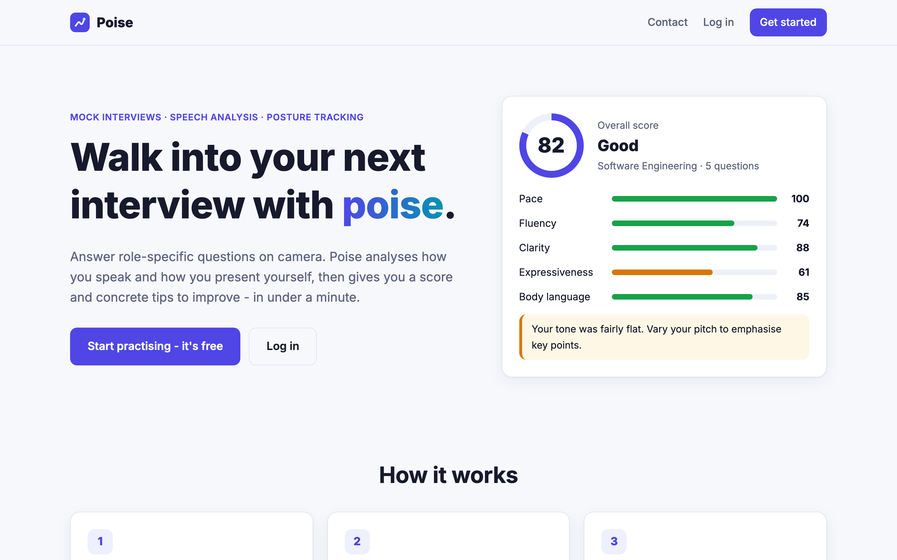
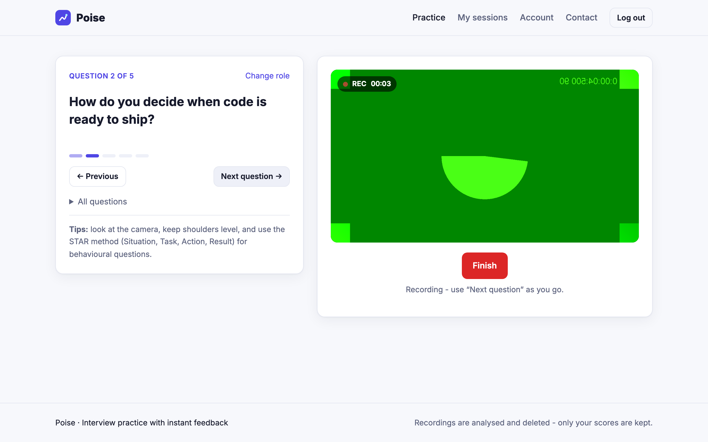
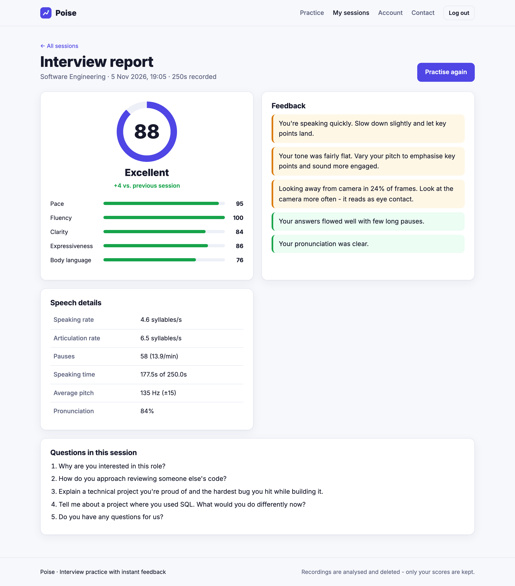
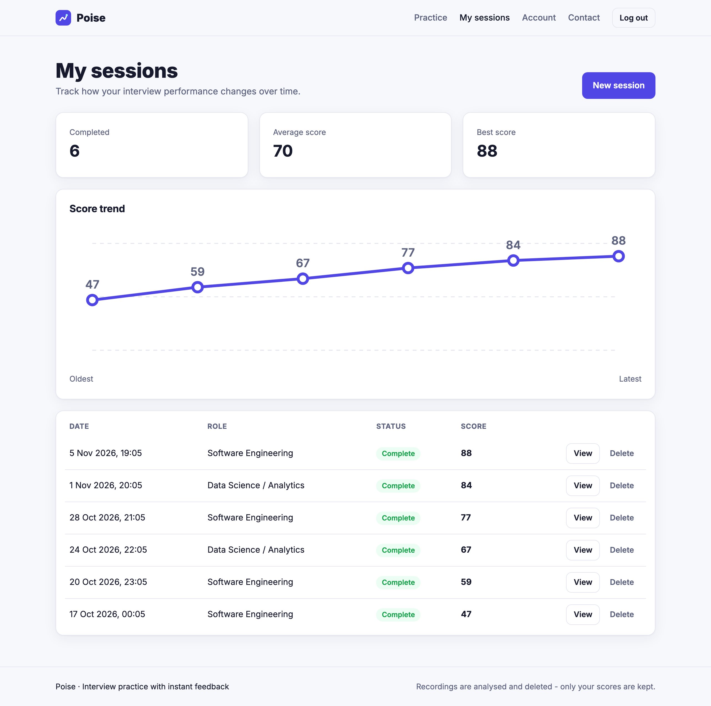
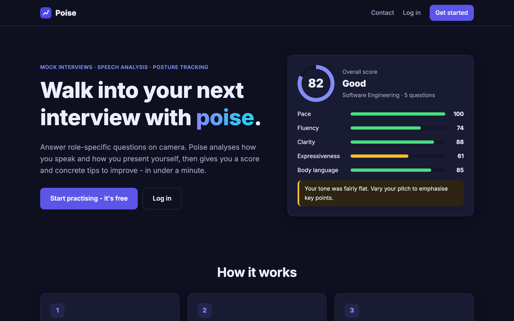
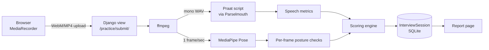

<div align="center">


# Poise

**Practise interviews on camera and get instant feedback on how you speak and how you present yourself.**

[](https://github.com/Lazypilottt/poise/actions/workflows/ci.yml)




</div>

---

Poise is a mock-interview web app. You pick a target role, answer a set of tailored questions in front of your webcam, and within seconds get a report that scores your **pace, fluency, clarity, vocal expressiveness and body language**, with specific tips and a history of your progress.

All analysis runs on your own server, with no cloud services or paid APIs: speech is measured with **Praat** (through Parselmouth) and posture with **MediaPipe Pose**. The raw recording is deleted as soon as it has been analysed.

## Features

- **Personalised question sets.** Questions are built from your role, experience level and skills (opener, role-specific, skill-based, behavioural, closer).
- **In-browser recording.** The browser records camera and microphone with `MediaRecorder`, and you step through the questions while recording.
- **Speech analysis.** Speaking rate, articulation rate, pauses per minute, speech-to-silence ratio, pitch statistics and a pronunciation score.
- **Body-language analysis.** Pose estimation on sampled frames detects slouching, tilted head or shoulders, looking away from the camera, and sitting too close or too far.
- **Scored report.** You get a 0–100 overall score, five category scores, prioritised tips and an annotated posture snapshot.
- **Progress tracking.** Session history shows a score trend, average and best score, and the change since your last attempt.
- **Accounts and privacy.**
  - Sign-up, login, password change and per-user data isolation.
  - Snapshots are served only to their owner.
  - Recordings are never stored.
- **Responsive UI** with light and dark mode, built without a frontend framework.

## Screenshots

| Interview | Report |
| --- | --- |
|  |  |
| **Progress** | **Dark mode** |
|  |  |

## How it works



1. **Decode.** `ffmpeg` extracts a 44.1 kHz mono WAV and samples one frame per second. ffmpeg is used instead of OpenCV because `MediaRecorder` WebM files usually carry no reliable frame-rate metadata.
2. **Speech.** A Praat script detects syllable nuclei from intensity peaks and voicing. It runs once per recording and reports 15 measurements.
3. **Posture.** For each sampled frame, MediaPipe returns landmarks for the nose, ears and shoulders. Each frame is checked with simple, explainable geometry:

   | Check | Rule |
   | --- | --- |
   | Slouching | `(shoulder_mid_y − nose_y) / shoulder_width < 0.32` |
   | Uneven shoulders | shoulder line > 8° from horizontal |
   | Head tilt | ear line > 12° from horizontal |
   | Looking away | nose offset from ear midpoint > 30% of ear distance, or an ear not visible |
   | Framing | shoulder width outside 18–85% of frame width |

4. **Score.** Each metric is mapped onto a 0–100 band with an ideal range:

   | Category | Signal | Ideal range | Weight |
   | --- | --- | --- | --- |
   | Pace | syllables / second | 3.0–4.5 (≈130–170 wpm) | 20% |
   | Fluency | speech ratio and pauses / minute | ≥ 65% speech, ≤ 15 pauses/min | 20% |
   | Clarity | pronunciation probability | higher is better | 20% |
   | Expressiveness | pitch std / mean | 0.12–0.30 | 15% |
   | Body language | share of frames with no posture issues | higher is better | 25% |

   If no video frames are available, body language is skipped and the other weights are renormalised.

## Tech stack

| Layer | Tools |
| --- | --- |
| Backend | Python 3.11, Django 5, SQLite |
| Speech | Praat, Parselmouth |
| Vision | MediaPipe Pose, OpenCV |
| Media | ffmpeg |
| Frontend | Django templates, vanilla JS (`getUserMedia`, `MediaRecorder`), hand-written CSS |
| Ops | GitHub Actions CI, Docker, Gunicorn, WhiteNoise |

## Project structure

```
poise/
├── config/                  # Django project settings and root URLs
├── coach/                   # The app
│   ├── analysis/
│   │   ├── media.py         # ffmpeg helpers (audio + frame extraction)
│   │   ├── speech.py        # Praat runner and output parser
│   │   ├── posture.py       # MediaPipe runner + pure geometry checks
│   │   ├── scoring.py       # Metric → score bands, weights, feedback tips
│   │   ├── pipeline.py      # End-to-end analysis of one recording
│   │   └── praat/           # Praat syllable-nuclei script
│   ├── management/commands/seed_demo.py
│   ├── questions.py         # Question bank and selection
│   ├── models.py            # InterviewSession
│   ├── views.py / urls.py / forms.py
│   └── tests/               # Unit and integration tests
├── templates/               # Base layout, auth pages, app pages
├── static/                  # app.css, recorder.js, logo
├── Dockerfile
└── requirements.txt
```

## Getting started

### Prerequisites

- Python 3.11
- [ffmpeg](https://ffmpeg.org/download.html) on your `PATH` (`brew install ffmpeg` / `sudo apt install ffmpeg`)

### Run locally

```bash
git clone https://github.com/Lazypilottt/poise.git
cd poise

python3.11 -m venv .venv
source .venv/bin/activate
pip install -r requirements.txt

cp .env.example .env          # optional, defaults work for local dev
python manage.py migrate
python manage.py runserver
```

Open http://localhost:8000, create an account and start a session. Browsers only allow camera access on `localhost` or HTTPS.

**Explore without recording:**

```bash
python manage.py seed_demo    # creates user "demo" / "poise-demo-123" with sample sessions
```

### Run with Docker

```bash
docker build -t poise .
docker run -p 8000:8000 -e DJANGO_SECRET_KEY=change-me -v poise-data:/data poise
```

### Run the tests

```bash
python manage.py test
```

The suite covers the Praat output parser, the posture geometry, the scoring bands and tips, question selection, and the full HTTP flow: auth, practice setup, submission, ownership checks and history. The ML pipeline is mocked in view tests, so they run in a few seconds.

## Configuration

Every setting is read from environment variables, optionally via a `.env` file. See [`.env.example`](.env.example).

| Variable | Default | Purpose |
| --- | --- | --- |
| `DJANGO_DEBUG` | `1` | Debug mode |
| `DJANGO_SECRET_KEY` | dev key | **Required** when debug is off |
| `DJANGO_ALLOWED_HOSTS` | `localhost,127.0.0.1` | Comma-separated hosts |
| `DJANGO_HTTPS` | `0` | Secure cookies, SSL redirect and HSTS behind HTTPS |
| `FFMPEG_BINARY` | `ffmpeg` | Path to ffmpeg |
| `MAX_RECORDING_MB` | `200` | Upload size limit |
| `EMAIL_HOST_USER` / `EMAIL_HOST_PASSWORD` | empty | SMTP for the contact form; prints to console if unset |

## Privacy

- Uploaded recordings and every intermediate file (WAV, frames, TextGrids) live in a temporary directory that is deleted after analysis.
- Only derived metrics and one annotated snapshot are stored.
- Snapshots are served through an authenticated view that checks ownership. They are never exposed as public media.
- Users can delete any session, together with its snapshot.

## Limitations and next steps

- Analysis runs synchronously in the request, which takes about 10–60 s depending on length. A task queue (Celery/RQ) with progress polling would scale better.
- Score thresholds are heuristics tuned on a small set of webcam recordings, not a validated model.
- Content is not evaluated yet. Adding speech-to-text (e.g. Whisper) would enable filler-word counts and answer-relevance feedback.
- Per-question timestamps could split the report by question.

## Acknowledgements

- The syllable-nuclei Praat script is adapted from [my-voice-analysis](https://github.com/Shahabks/my-voice-analysis) by Shahab Sabahi, which builds on work by De Jong & Wempe (2009).
- [Parselmouth](https://github.com/YannickJadoul/Parselmouth) for the Python interface to Praat.
- [MediaPipe](https://developers.google.com/mediapipe) for pose estimation.

## License

[MIT](LICENSE). The bundled Praat script keeps its original author's notice.
